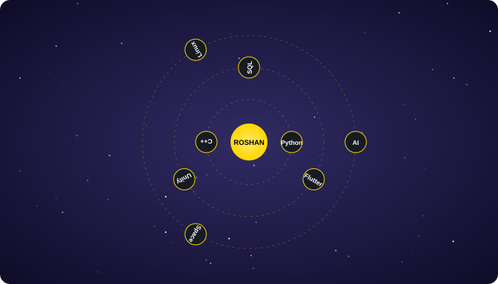
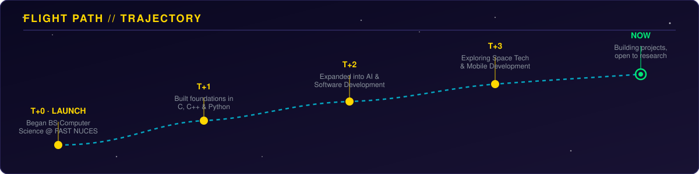
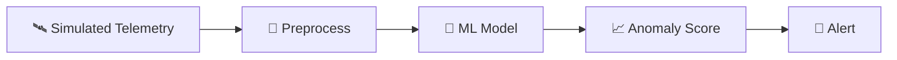
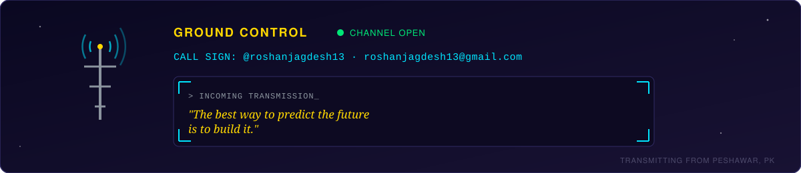

<div align="center">


<br/><br/>


<br/><br/>


</div>

<br/>

## 🛰️ Flight Log

```text
> boot sequence: roshan_jagdesh.exe
> role        : Computer Science Student & Developer
> trajectory  : BS Computer Science — FAST NUCES Peshawar
> payload     : Software Development · AI · Space Technology
> objective   : turning curiosity into code, and ideas into projects
> current     : learning, building and exploring new technologies 🚀
```

<br/>

## 🧑‍🚀 Crew Manifest

| | |
|---|---|
| **Callsign** | Roshan Jagdesh |
| **Role** | Computer Science Student & Developer |
| **Academy** | FAST NUCES, Peshawar |
| **Specialisation** | AI · Software · Space Technology |
| **Mission Status** | 🟢 Active — open to collaboration & internships |

<br/>

## 🚀 Onboard Systems

<div align="center">


<br/>

**C, C++ · Python · Flutter · HTML, CSS, JavaScript · SQL · Linux · Figma · Unity**

</div>

<br/>

## 🪐 Skill Orbit

<div align="center">



</div>

<br/>

## 🌌 Current Mission

```text
┌──────────────────────────────────────────────────────────┐
│                    CURRENT OBJECTIVES                     │
├──────────────────────────────────────────────────────────┤
│ 🧠 AI              → Exploring intelligent systems        │
│ 🛰️ Space Tech      → Exploring satellite-based ideas      │
│ 💻 Software        → Building practical applications      │
│ 📱 Flutter         → Developing mobile applications        │
│ 🎮 Unity           → Exploring interactive experiences     │
│ 📚 Learning        → Improving CS & problem-solving        │
└──────────────────────────────────────────────────────────┘
```

<br/>

## 🪐 Flight Path

<div align="center">



</div>

<br/>

## 🌍 Projects in Orbit

* 🛰️ **AI-Powered Satellite Anomaly Detection** — exploring AI-based detection of unusual satellite behavior using simulated satellite data.
* 📱 **Task Manager App** — a Flutter-based mobile application for managing tasks.
* 💻 **C/C++ Projects** — developing programming and data-structure based applications.

<br/>

## 📋 Mission Brief: Satellite Anomaly Detection



| | |
|---|---|
| **Objective** | Detect unusual satellite behaviour automatically |
| **Stack** | Python · scikit-learn · Pandas |
| **Status** | 🟡 Prototype in progress |
| **Next Burn** | Train and evaluate the first model |

<br/>

## ⏱️ Mission Timeline

| Phase | Milestone | Status |
|---|---|---|
| **Foundations** | C/C++ and problem solving | ✅ Done |
| **Mobile** | First Flutter app | ✅ Done |
| **AI + Space** | Satellite anomaly prototype | 🔄 In progress |
| **Interactive** | Ship a Unity project | ⏳ Planned |
| **Open Source** | Contribute to a space-tech project | ⏳ Planned |

<br/>

## 📊 Mission Telemetry

<div align="center">


<br/>


</div>

<br/>

## 🌠 Learning Trajectory

```text
Computer Science
       │
       ├── Programming & Problem Solving
       │
       ├── C / C++
       │
       ├── Python & AI
       │
       ├── Mobile Development
       │
       ├── Software Development
       │
       └── Space Technology 🛰️
```

<br/>

## 🌌 Ground Control

<div align="center">



<br/><br/>

<a href="https://github.com/roshanjagdesh13">

</a>
<a href="mailto:roshanjagdesh13@gmail.com">

</a>

</div>

<br/>

<div align="center">


<br/><br/>


</div>
