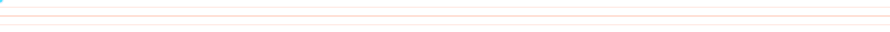
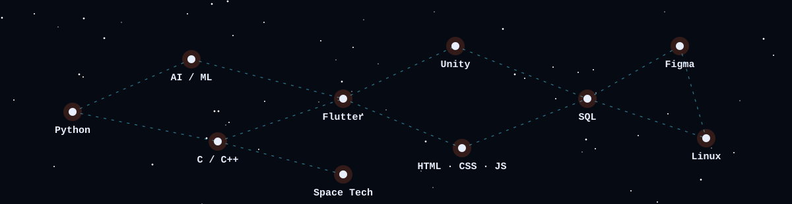

## Three lanes, one trajectory

| Lane 1: Orbit | Lane 2: Neural | Lane 3: Ground |
|---|---|---|
| **Space.** Building an AI-powered satellite anomaly detection prototype on simulated telemetry. | **AI.** Exploring intelligent systems and learning Python and AI from the ground up. | **Dev.** A Flutter Task Manager, C/C++ data-structure projects and Unity experiments. |
| Next stop: train and evaluate the first model | Next stop: a first ML model on real signals | Next stop: ship a Unity project |

## Stack, charted

## Telemetry

